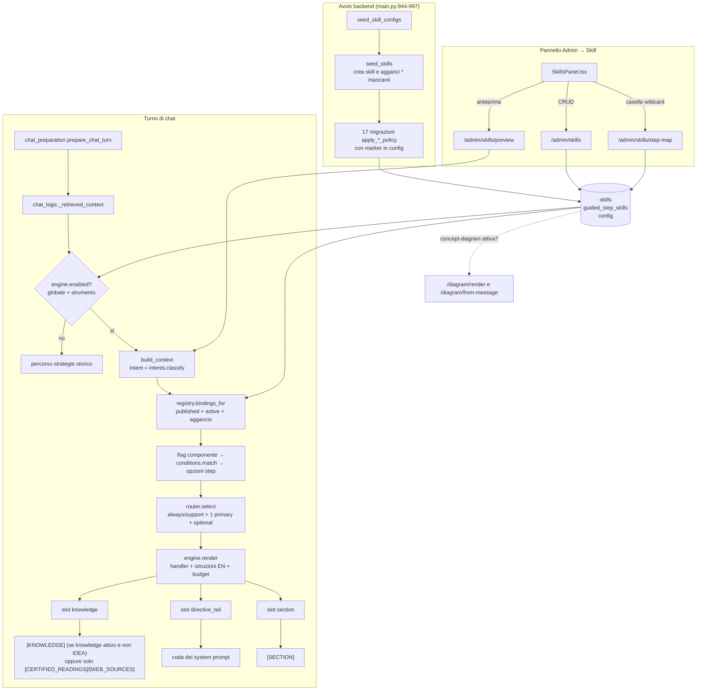

# La componente «Skill» di Counselorbot

Audit in sola lettura del 23 ottobre 2026 (branch `docs/skills-component-audit`, base `a203ca66`).
Scopo: capire come funziona la componente e decidere come migliorarla. Nessun codice applicativo è stato modificato.

> **Tre cose diverse si chiamano «skill».** Questo documento parla solo della prima.
>
> | Nome | Dove | Cos'è |
> |---|---|---|
> | **Skill della chat** | `backend/skills/`, tabelle `skills` e `guided_step_skills` | Pezzi di istruzioni (e materiale recuperato) che il server aggiunge al prompt del modello in un turno di chat. |
> | Skill PQBL | `backend/pqbl_generator.py:9`, `models.py:559` (colonna `skill`) | La competenza («saper …») a cui si riferisce un gruppo di domande a scelta multipla. Nessun legame col motore. |
> | Skill degli agenti | `.claude/skills/` (`caveman`, `grill-with-docs`, …) | Istruzioni per gli agenti di sviluppo (Claude Code). Non girano nel prodotto. |

---

## 1. Cos'è una Skill, in parole semplici

Una skill è un **comportamento in più che il counselor virtuale può avere in un certo momento della conversazione**.
Ognuna ha un testo di istruzioni (in inglese, rivolto al modello) e, se serve, un pezzo di codice (l'«handler») che va a prendere materiale verificato: strategie certificate, letture del catalogo, estratti di Wikipedia, referenti dell'istituto.

Per lo **studente** vuol dire che, a seconda di quello che chiede, il counselor:

- dà un consiglio concreto preso dal catalogo certificato (`certified-advice`);
- chiarisce cosa significa un risultato quando lo studente è confuso (`profile-wayfinder`);
- propone letture o film verificabili, senza inventare titoli (`reading-guide`);
- confronta due suoi profili senza inventare dati (`profile-comparison`);
- risponde a una domanda fattuale («chi è Vygotskij?») da fonti pubbliche (`web-lookup`);
- dice a chi rivolgersi nel proprio istituto e quali eventi ci sono (`referral-guide`);
- disegna uno schema quando la risposta lo richiede (`concept-diagram`);
- nello strumento **Idea**, fa crescere la mappa dell'idea (`idea-focus`).

Per il **docente/admin** una skill è una riga configurabile nel pannello *Admin → Skill*: si può pubblicare o lasciare in bozza, cambiarne le istruzioni, le condizioni («solo se lo studente chiede un consiglio»), agganciarla o sganciarla da uno strumento, e vedere un'anteprima di cosa entrerebbe nel prompt.

Il principio di fondo: **le regole decidono quando una skill vale, il codice recupera i dati, il modello riceve solo testo già filtrato.** Il divieto di inventare fonti diventa così un filtro, non solo una raccomandazione al modello.

---

## 2. Ciclo di vita

### 2.1 Modello dati

| Tabella | Riga | Campi chiave |
|---|---|---|
| `skills` (`models.Skill`) | `backend/models.py:1405` | `slug` univoco; `description` (letta dal router LLM); `instructions_i18n` = `{"en": "..."}` (solo inglese); `conditions` (JSON dichiarativo); `handler` (nome in whitelist) + `handler_params`; `routing` (`always` / `support` / `primary` / `optional`); `slot` (`section` / `knowledge` / `directive_tail`); `max_chars`; `sort_order`; `is_active`; `status` (`draft` / `published`). |
| `guided_step_skills` (`models.GuidedStepSkill`) | `backend/models.py:1435` | `questionnaire_type`, `step_id` (`"*"` = tutti gli step), `skill_id`, `sort_order`, `enabled`, `override_params`. Nessuna foreign key verso `skills.id`. |

Configurazioni globali nella tabella `config` (seed in `backend/skills_seed.py:227-250`):
`skills_engine_enabled`, `skills_engine_instruments` (lista JSON degli strumenti serviti), `skills_router_threshold` (3), `skills_router_model`, `skills_router_timeout_s` (6), `skills_total_max_chars` (6500), `web_lookup_enabled` (true).

### 2.2 Seed all'avvio

`backend/main.py:944-997`, dentro un unico `try`:

1. `seed_skill_configs` (`skills_seed.py:422`) — inserisce le config mancanti, non sovrascrive.
2. `seed_skills` (`skills_seed.py:1006`) — crea le skill mancanti per `slug` (sempre `status="published"`) e **ricrea ogni aggancio wildcard `*` mancante** per gli strumenti di `bind_instruments` (default: i 7 questionari storici).
3. Diciassette migrazioni una tantum `apply_*_policy`, ognuna protetta da un marker in `config` (`skills_seed.py:181-199`). Alcune riscrivono le istruzioni solo se il testo attuale ha l'MD5 della versione di serie precedente, per non toccare le personalizzazioni dell'admin (es. `apply_idea_wayfinder_policy`, `skills_seed.py:916`). `apply_english_skill_instructions_policy` (`skills_seed.py:565`) ha ridotto tutte le istruzioni a `{"en": ...}`.

Un'eccezione in un punto qualsiasi della catena viene registrata come `Seed skill fallito` (`main.py:996-997`) e salta tutte le migrazioni successive.

### 2.3 Configurazione admin

API in `backend/routes/skills.py` (tutte richiedono `get_current_active_admin`):

| Metodo e percorso | Riga | Cosa fa |
|---|---|---|
| `GET /admin/skills` | 51 | Elenco ordinato per `sort_order`. |
| `GET /admin/skills/handlers` | 63 | Nomi degli handler registrati. |
| `POST /admin/skills` | 70 | Crea; 409 se lo slug esiste; `_validate` (riga 24) controlla istruzioni solo-inglese, `routing`, `slot`, `status`, `handler`. |
| `GET /admin/skills/step-map?questionnaire_type=` | 91 | Agganci di uno strumento. |
| `PUT /admin/skills/step-map` | 119 | Sostituisce **tutti** gli agganci dello strumento (delete + insert). |
| `PUT /admin/skills/{id}` | 153 | Aggiorna i campi inviati. |
| `DELETE /admin/skills/{id}` | 176 | 409 se la skill è ancora agganciata. |
| `POST /admin/skills/preview` | 193 | Esegue il motore su uno step e un messaggio di prova, ritorna blocchi, id e *trace* (motivo di ogni esclusione). |

Interfaccia: `frontend/src/components/admin/SkillsPanel.tsx` (scheda `skills` in `frontend/src/app/admin/page.tsx:288`). Le traduzioni dell'interfaccia (it/en/es/fr/de/sv) stanno dentro il componente (`SkillsPanel.tsx:54-130`), non nei file i18n condivisi. Il pannello offre: tabella delle skill, form di modifica (istruzioni EN, condizioni e parametri come JSON grezzo, handler, routing, slot, stato), una casella per aggancio wildcard per strumento (`SkillsPanel.tsx:396-404`) e l'anteprima.

### 2.4 Mappa step → skill

`registry.bindings_for` (`backend/skills/registry.py:35`): prende gli agganci `enabled` dello strumento per lo step corrente e per `*`; se una skill ha entrambi, vince quello esplicito. Poi tiene solo le skill `is_active` e `published`. I parametri sono `handler_params` della skill aggiornati da `override_params` dell'aggancio. L'interfaccia admin gestisce solo gli agganci `*`: agganci per singolo step e `override_params` esistono nell'API ma non nel pannello.

### 2.5 Esecuzione a runtime

Chiamante unico in produzione: `chat_logic._retrieved_context` (`backend/chat_logic.py:2392`), invocato da `chat_preparation.prepare_chat_turn` (`backend/chat_preparation.py:422-445`) per chat sincrona, streaming e audit del prompt. L'anteprima admin è il secondo chiamante.

1. **Interruttore** — `engine.enabled` (`skills/engine.py:182`): motore acceso globalmente **e** strumento nella lista `skills_engine_instruments`. Se spento, `_retrieved_context` usa il vecchio percorso strategie (`chat_logic.py:2595-2633`).
2. **Contesto** — `engine.build_context` (`engine.py:208`) fotografa il turno in un `SkillContext` (`skills/context.py:10`): strumento, step, `step_mode`, lingua, **intent**, messaggio, punteggi, fattori salienti, bande, flag dei componenti del prompt, opzioni per step, profili (solo per intent `compare`), fonti RAG già recuperate, fascia di pubblico. L'intent arriva da `intents.classify` (`skills/intents.py:176`): regex deterministiche, ordine `compare → referral → factual → reading → advice → clarify`, altrimenti `guided` o vuoto.
3. **Filtri** — `engine.run_skills` (`engine.py:266`): per ogni aggancio, il flag del componente (`COMPONENT_FLAG_BY_SLUG`, `registry.py:16`), poi `conditions.match` (`skills/conditions.py:28`; chiavi ammesse a riga 16; chiave sconosciuta = skill spenta), poi le opzioni per step (limite strategie, esclusioni già mostrate, strategie ammesse).
4. **Selezione** — `router.select` (`skills/router.py:33`): `always`/`support` passano sempre; fra le `primary` ne passa una sola (LLM se ce n'è più d'una, altrimenti fallback per `sort_order`); le `optional` passano tutte fino a `skills_router_threshold`, oltre decide l'LLM con timeout. Il prompt del router è in italiano (`router.py:22`).
5. **Rendering** — `engine.render` (`engine.py:72`): ordine per rango (strutturali → primary → resto) poi `sort_order`. Esegue l'handler (`handlers.get_handler`, `skills/handlers.py:49`); se l'handler dice «non applicabile», cadono anche le istruzioni. Istruzioni = sempre `instructions_i18n["en"]` (`engine.py:49`), indipendentemente dalla lingua dello studente: la lingua della risposta la impone il resto del prompt. L'handler può mettere il materiale in uno slot diverso dalle istruzioni (di solito dati in `knowledge`, direttiva in `directive_tail`). Tetto per skill `max_chars`, tetto totale `skills_total_max_chars`; un blocco che non ci sta viene scartato e annotato nella trace.
6. **Iniezione nel prompt** — `build_context_envelope` (`chat_logic.py:2992`):
   - `section` → blocco `[SECTION]` dopo il ruolo (`chat_logic.py:3072-3074`; nessuna skill lo usa);
   - `knowledge` → dentro `[KNOWLEDGE]` insieme a RAG e risposte votate (`chat_logic.py:2645-2655`), oppure, se il componente `knowledge` è spento, solo i blocchi che iniziano con `[CERTIFIED_READINGS]` o `[WEB_SOURCES]` (`chat_logic.py:3307-3316`);
   - `directive_tail` → in coda al system prompt (`chat_logic.py:3318-3320`).
7. **A valle** — gli `ids` (`certified-advice`, `reading-guide`, `approved-strategies`) e i `meta` vanno a log, feedback e barra laterale delle raccomandazioni (`chat_logic.py:2584-2594`).

Caso a parte: **`concept-diagram` fa anche da interruttore di funzione**. `routes/diagram.py:148-155` risponde 404 su `/diagram/render` e `/diagram/from-message` se la skill non è attiva e pubblicata.

---

## 3. Skill e handler esistenti oggi

Handler registrati (`skills/handlers.py`): `certified_strategies` (205), `approved_strategies` (239), `profile_comparison` (262), `reading_sources` (353), `web_lookup_sources` (419), `orientation_referrals` (464).

| Slug | Handler | Routing | Slot istr. / dati | Condizioni | Strumenti agganciati dal seed | Note |
|---|---|---|---|---|---|---|
| `approved-strategies` | `approved_strategies` | optional | knowledge | — | nessuno | **Spenta e non agganciata** dal seed (`skills_seed.py:253-269`). Resta per compatibilità col percorso a motore spento. |
| `certified-advice` | `certified_strategies` | primary | directive_tail / knowledge `[CERTIFIED_STRATEGIES]` | intent `advice`, `guided` | 7 questionari | Rispetta i flag `certified_strategies`, limite per step, esclusioni. |
| `profile-wayfinder` | — | primary | directive_tail | intent `clarify` | 7 questionari | Solo istruzioni. |
| `reading-guide` | `reading_sources` | primary | directive_tail / knowledge `[CERTIFIED_READINGS]` + `[READING_SOURCES]` | intent `reading` | tutti i 12 strumenti | Catalogo letture certificato + fonti RAG del turno. |
| `profile-comparison` | `profile_comparison` | primary | directive_tail / knowledge `[COMPARABLE_PROFILES]` | intent `compare` | 7 questionari | Legge anche i taccuini di prova. |
| `web-lookup` | `web_lookup_sources` | primary | directive_tail / knowledge `[WEB_SOURCES]` | intent `factual` | tutti i 12 strumenti | Max 5 consultazioni per sessione, contatore in memoria. |
| `concept-diagram` | — | optional | directive_tail | — | 7 questionari | Interruttore di `/diagram/*`. |
| `idea-focus` | — | always | directive_tail | — | solo `IDEA` | Contratto della patch della mappa. |
| `referral-guide` | `orientation_referrals` | primary | directive_tail / knowledge `[REFERRALS]` | intent `referral` | tutti i 12 strumenti | Referenti ed eventi dell'istituto. |

«7 questionari» = `QSA, QSAr, ZTPI, QPCS, QPCC, QAP, SAVICKAS`; i 12 strumenti aggiungono `IDEA`, `EVENTO_STUDIO`, `EVENTO_PROFESSIONALE`, `OBIETTIVO_STUDIO`, `OBIETTIVO_DOCENZA` (`skills_seed.py:21-29`). Sui percorsi Evento e Obiettivo arrivano quindi solo letture, fonti pubbliche e referenti.

---

## 4. Diagramma del flusso

---

## 5. Problemi trovati

Le riproduzioni marcate «SQLite» sono script fuori dal repository che usano `DATABASE_URL=sqlite:///…` in una cartella temporanea, Python 3.11 locale, nessun container. Le due di prompt sostituiscono `skills_engine.run_skills` con uno stub che restituisce blocchi noti, così si verifica solo l'assemblaggio del prompt.

### 5.1 Bug

| # | Problema | Prova | Gravità |
|---|---|---|---|
| B1 | **Su IDEA il materiale delle skill non arriva mai al modello.** Con i flag predefiniti (`knowledge=True`), `_retrieved_context` scarta tutti i blocchi `knowledge` quando lo strumento è IDEA (`chat_logic.py:2420-2423` e `2652`), e il recupero nell'envelope scatta solo se il flag è spento (`chat_logic.py:3307`). `get_prompt_component_flags` non spegne `knowledge` per IDEA (`chat_logic.py:2699-2716`). Arriva la direttiva («cita solo le fonti in [WEB_SOURCES]») ma non le fonti. Il messaggio del commit `dc313da2` dava per scontato che IDEA spegnesse `knowledge`; il test aggiunto lì (`test_smoke.py`, `test_build_context_envelope_source_markers_pass_the_knowledge_gate`) passa `knowledge: False` a mano, quindi non copre il percorso reale. | SQLite: `IDEA default flags knowledge = True` → `IDEA knowledge_context has … CERTIFIED_READINGS: False`, `QSA … True`; envelope `IDEA knowledge=True (default) -> [CERTIFIED_READINGS]: False, [WEB_SOURCES]: False, referral data: False, referral directive: True`. Non verificato sulla config di produzione (una config salvata per gli step IDEA potrebbe spegnere `knowledge`). | **alta** |
| B2 | **`[REFERRALS]` non passa il cancello `knowledge`.** Quando un admin spegne `knowledge` per uno step, passano solo `[CERTIFIED_READINGS]` e `[WEB_SOURCES]` (`chat_logic.py:3311-3313`); i referenti (`orientation_referral_service.py:164`) cadono mentre la direttiva di `referral-guide` resta. Anche `[READING_SOURCES]` non è nella lista, ma in quel caso l'handler ha già svuotato le fonti, quindi l'effetto è solo sui referenti. | SQLite: envelope `IDEA knowledge=False -> referral data: False … [CERTIFIED_READINGS]: True, [WEB_SOURCES]: True, referral directive: True`. | media |
| B3 | **Rinominare una skill con uno slug già usato dà 500.** `update_skill` non controlla l'unicità (`routes/skills.py:153-173`), `create_skill` sì (riga 78). | SQLite + TestClient: `PUT web-lookup {"slug":"reading-guide"}` → `500 Internal Server Error`. | media |
| B4 | **Una skill di serie cancellata ritorna al riavvio**, pubblicata e agganciata. `seed_skills` ricrea gli slug mancanti e gli agganci `*` mancanti a ogni avvio (`skills_seed.py:1006-1050`). Lo stesso vale per un aggancio rimosso con `PUT /step-map` (non per la casella del pannello, che mette solo `enabled=false`). Rinominare lo slug di una skill di serie ha lo stesso effetto (ne nasce un doppione) e rompe i riferimenti scritti nel codice (`COMPONENT_FLAG_BY_SLUG`, `skills_result.ids.get("certified-advice")`, `diagram.SKILL_SLUG`). | SQLite: `DELETE concept-diagram: 200`; dopo `seed_skills` `concept-diagram exists again: True`; `concept-diagram bound again on QSA: True`. | media |
| B5 | **Chiavi di condizione sbagliate accettate al salvataggio.** `_validate` non guarda `conditions` (`routes/skills.py:24-49`); a runtime una chiave sconosciuta spegne la skill (`conditions.py:35-38`) e lo si scopre solo dalla trace dell'anteprima. | SQLite + TestClient: `POST /admin/skills` con `{"intent": ["advice"]}` → `200`. | bassa |
| B6 | **L'anteprima admin non riproduce il turno reale.** Passa `component_flags={}` e `handler_options={}`, nessuna sessione, utente o fonte RAG, classifica l'intent con un'altra regola `guided` (`routes/skills.py:205-221` contro `chat_logic.py:2553-2581`); il pannello non invia mai `language` (`SkillsPanel.tsx:260-268`, default `"it"`). L'anteprima può dire «entra» per una skill che in chat resta fuori (step con flag spenti, strategie già mostrate) e viceversa. | Lettura del codice; non riprodotto end-to-end. | media (sospetto) |

### 5.2 Codice morto e incoerenze

| # | Problema | Prova | Gravità |
|---|---|---|---|
| I1 | Doppio percorso: con motore spento la chat usa ancora il vecchio recupero strategie (`chat_logic.py:2595-2633`), mantenuto in parallelo al motore; `approved-strategies` esiste ma è spenta e mai agganciata. | `skills_seed.py:253-269`, `skills_seed.py:229-231` | bassa |
| I2 | Slot `section` previsto ma inutilizzato («nessuna skill lo usa nel pilota»). | `chat_logic.py:3072` | bassa |
| I3 | `_instructions(skill, language)` ignora `language`. | `skills/engine.py:49-55` | bassa |
| I4 | Commenti e docstring superati: `routing  # always | optional` (mancano `support`, `primary`) in `models.py:1425`; «istruzioni multilingua» in `skills/__init__.py:4`; «Spenta per default» per web-lookup in `handlers.py:424`, ma il default è `true` (`skills_seed.py:243-249`). | file:riga indicati | bassa |
| I5 | Prompt del router in italiano mentre il contratto delle istruzioni è solo inglese. | `skills/router.py:22-28` | bassa |
| I6 | Il parametro `allowed_strategies` viene copiato nei parametri di **ogni** skill, non solo di quelle sulle strategie, e `binding.params` viene sovrascritto sul posto. | `skills/engine.py:290-293` | bassa |
| I7 | Diciassette migrazioni una tantum in un solo `try`, con una lunga `or` di flag solo per un log; un errore a metà salta tutte le successive in silenzio (solo un warning). | `main.py:944-997` | media |
| I8 | Contatore web-lookup in memoria per processo: si azzera al riavvio e non è condiviso fra worker. Dichiarato «tetto di cortesia». | `handlers.py:412-441` | bassa |
| I9 | `guided_step_skills.skill_id` senza foreign key: la coerenza dipende da `put_step_map` e `delete_skill`. | `models.py:1447` | bassa |

### 5.3 UX del pannello admin

| # | Problema | Prova | Gravità |
|---|---|---|---|
| U1 | **Manca il controllo `is_active`**: il form lo legge e lo rimanda (`SkillsPanel.tsx:200, 221`) ma non c'è una casella; l'unica casella del pannello è quella degli agganci (riga 400). Per riattivare `approved-strategies` serve l'API. | `grep -n "checked=" SkillsPanel.tsx` → solo riga 400 | media |
| U2 | Solo agganci wildcard: niente agganci per singolo step né `override_params`, che il motore supporta. | `SkillsPanel.tsx:246-249`, `registry.py:49-55` | media |
| U3 | Condizioni e parametri come JSON grezzo, senza elenco delle chiavi ammesse né degli intent possibili. | `SkillsPanel.tsx` textarea condizioni/parametri | media |
| U4 | Nessun avviso che le skill di serie cancellate tornano (vedi B4) né che lo slug è usato dal codice. | — | media |
| U5 | Lista strumenti scritta a mano nel componente (`SkillsPanel.tsx:52`), duplicata da `ENGINE_INSTRUMENTS` (`skills_seed.py:29`). Nessuna indicazione se il motore è acceso per lo strumento finché non si lancia l'anteprima. | file:riga indicati | bassa |
| U6 | Testi di interfaccia dentro il componente invece che nei file i18n condivisi. | `SkillsPanel.tsx:54-130` | bassa |
| U7 | `remove` ricarica la lista anche quando la cancellazione fallisce; nessuna conferma prima di cancellare. | `SkillsPanel.tsx:239-243` | bassa |

### 5.4 Test mancanti

- Nessun test del percorso reale IDEA → prompt con skill di fonti (B1): `test_idea_is_bound_to_sources_like_the_other_instruments` (`test_skills_parity.py:222`) controlla solo che l'aggancio esista.
- Nessun test sul cancello `knowledge` per `[REFERRALS]` (B2).
- Nessun test su `PUT /admin/skills/{id}` con slug duplicato (B3), su cancellazione + riseed (B4), su condizioni non valide al salvataggio (B5).
- Nessun test che confronti anteprima e turno reale (B6).
- Nessun test frontend per `SkillsPanel.tsx` (l'unico file di test che lo cita è `frontend/src/lib/event-instrument-parity.test.ts`).
- I test di motore con DB (`test_skills_parity.py`, `test_skills_specialized.py`, `test_skills_budget.py`) richiedono Postgres `counselorbot_test`; quelli puri (`test_skills_engine.py`, `test_skills_conditions.py`, `test_skills_router.py`, `test_skills_intents.py`) no.

### 5.5 Documentazione

- `CONTEXT.md:141` indica `skills_total_max_chars` a **4500**; il valore di serie è **6500** dal marker `skills_total_budget_6500_v1` (`skills/engine.py:23`, `skills_seed.py:199`).
- `CONTEXT.md:141` elenca cinque comportamenti `primary`; manca `referral-guide`.
- `docs-counselorbot/funzionalita-counselorbot.md` non spiega le skill (una sola menzione, riga 2087).
- Non esisteva un documento di architettura della componente: è questo.

---

## 6. Proposte di miglioramento (non implementate)

### Quick win (≤ mezza giornata ciascuna)

| # | Proposta | Effort | Rischio | Test necessari |
|---|---|---|---|---|
| Q1 | **Correggere B1+B2 insieme**: un'unica lista di marcatori di fonte (`[CERTIFIED_READINGS]`, `[WEB_SOURCES]`, `[REFERRALS]`) usata sia in `_retrieved_context` per IDEA sia nel cancello dell'envelope; IDEA tiene fuori RAG e strategie ma lascia passare le fonti delle skill. | 2-3 h | Basso-medio: cambia il prompt di IDEA (più contesto); controllare il budget di modello su IDEA. | Test di `_retrieved_context` + envelope per IDEA con flag predefiniti; test del cancello con `[REFERRALS]`; aggiornare il test smoke di `dc313da2`. |
| Q2 | 409 sullo slug duplicato in `update_skill`; rifiutare il cambio di slug delle skill di serie. | 1 h | Basso. | Test API: rinomina su slug esistente → 409; rinomina skill di serie → 400. |
| Q3 | Validare `conditions` in `_validate` con `KNOWN_CONDITION_KEYS` (e i valori di `intents`). | 1 h | Basso: skill esistenti con chiavi sbagliate non si potranno salvare finché non corrette (è il punto). | Test API 400 con chiave sconosciuta; 200 con chiavi valide. |
| Q4 | Casella `is_active` nel form del pannello. | 30 min | Basso. | Test componente o verifica manuale. |
| Q5 | Allineare `CONTEXT.md` (6500, `referral-guide`) e i commenti superati (I4). | 30 min | Nullo. | — |

### Medio (1-3 giorni)

| # | Proposta | Effort | Rischio | Test necessari |
|---|---|---|---|---|
| M1 | **Anteprima fedele**: estrarre da `_retrieved_context` la preparazione del `SkillContext` (flag di step, opzioni, intent, lingua) e usarla anche in `/admin/skills/preview`; il pannello invia lingua e, facoltativo, un utente o taccuino di prova. | 1-2 g | Medio: tocca il percorso caldo della chat. | Test che, a parità di input, anteprima e turno producano la stessa trace; test esistenti di parità. |
| M2 | **Skill di serie protette**: `DELETE` di una skill di serie risponde 409 «disattivala»; oppure un marker `deleted_by_admin` che `seed_skills` rispetta. Stesso trattamento per gli agganci rimossi. | 1 g | Medio: cambia il contratto dell'API. | Test: cancellazione rifiutata o durevole dopo `seed_skills`. |
| M3 | **Pannello più guidato**: editor di condizioni con menu (intent, strumenti, step_mode), agganci per step con `override_params`, indicatore «motore acceso per questo strumento», lista strumenti presa dall'API. | 2-3 g | Basso-medio (solo UI e un endpoint di lettura). | Test componente (Vitest) per toggle, salvataggio e validazione. |
| M4 | Rendere la catena di seed robusta: un `try` per migrazione, log dell'errore con il nome della policy. | 0,5-1 g | Basso. | Test che una policy che fallisce non blocchi le successive. |

### Grande (≥ 1 settimana)

| # | Proposta | Effort | Rischio | Test necessari |
|---|---|---|---|---|
| G1 | **Spegnere il percorso storico**: motore sempre attivo, rimozione del ramo `else` in `_retrieved_context` e della skill `approved-strategies` se non serve più. | 1 sett. | Alto: cambia il comportamento delle installazioni con motore spento; serve un'analisi di chi lo usa. | Suite di parità estesa, test di regressione su tutti gli strumenti. |
| G2 | **Skill come contratto dichiarato**: ogni skill dichiara i marcatori che produce e in che slot; il cancello `knowledge` e l'envelope leggono quella dichiarazione invece di liste scritte a mano. Elimina la classe di bug B1/B2. | 1-2 sett. | Medio-alto. | Test di contratto per ogni handler; test dell'envelope per ogni combinazione di flag. |
| G3 | **Osservabilità**: salvare la trace del motore per turno (già calcolata) nei log del prompt, così l'admin vede perché una skill non è entrata in una chat reale. | 1 sett. | Medio (volume dei log, privacy: la trace non contiene testo dello studente, va verificato). | Test che la trace venga salvata e non contenga dati personali. |

---

## 7. Cosa non ho potuto verificare

- **Config reale di produzione**: non ho letto il database. Se gli step IDEA hanno una config `prompt_components_IDEA_*` con `knowledge` spento, B1 in produzione si riduce a B2 (perdita dei soli referenti). Va controllato prima di correggere.
- **Test con Postgres** (`test_skills_parity.py`, `test_skills_specialized.py`, `test_skills_budget.py`, `test_smoke.py`): richiedono il database `counselorbot_test`; sul Mac da 8 GB non si avvia uno stack di test. Eseguiti invece i test puri: `test_skills_engine.py` (14 passed), `test_skills_conditions.py` + `test_skills_router.py` + `test_skills_intents.py` (37 passed).
- **Comportamento del modello**: non ho fatto turni di chat reali; le riproduzioni di B1/B2 verificano il prompt assemblato con un `run_skills` simulato, non gli handler veri né la risposta del modello.
- **Router LLM**: non chiamato (serve un provider); verificati solo fallback e parsing tramite i test esistenti.
- **Frontend**: nessun browser avviato; le osservazioni sul pannello vengono dalla lettura del codice.
- **Issue GitHub**: nessuna issue aperta tratta le skill; solo #59 cita il router come chiamata ausiliaria da misurare.

## Bug registrati nel Diario

Tutti registrati con `journal-cli add-bug` (nessuno NOT_REGISTERED). Solo B1 è collegato al compito `02ba0db0`, perché un compito accetta un solo bug collegato.

| # | Id Diario | Triage |
|---|---|---|
| B1 | `f0a80e24-0855-4cf2-bd9b-08d40721a91f` | confermato, alta |
| B2 | `5450520c-d01d-480a-b2f2-4facbe86129f` | confermato, media |
| B3 | `33cb88c2-c7c4-4ddb-9863-db4892f55113` | confermato, media |
| B4 | `ac72708a-5644-4cfd-bebe-49571c663921` | confermato, media |
| B5 | `4e567eb1-b314-4891-bc6e-4e78c5a0b03d` | confermato, bassa |
| B6 | `121c449e-f2ab-4b6f-9c61-0df5491abf9c` | sospetto, media |

## Bug non registrati

Nessuno.
