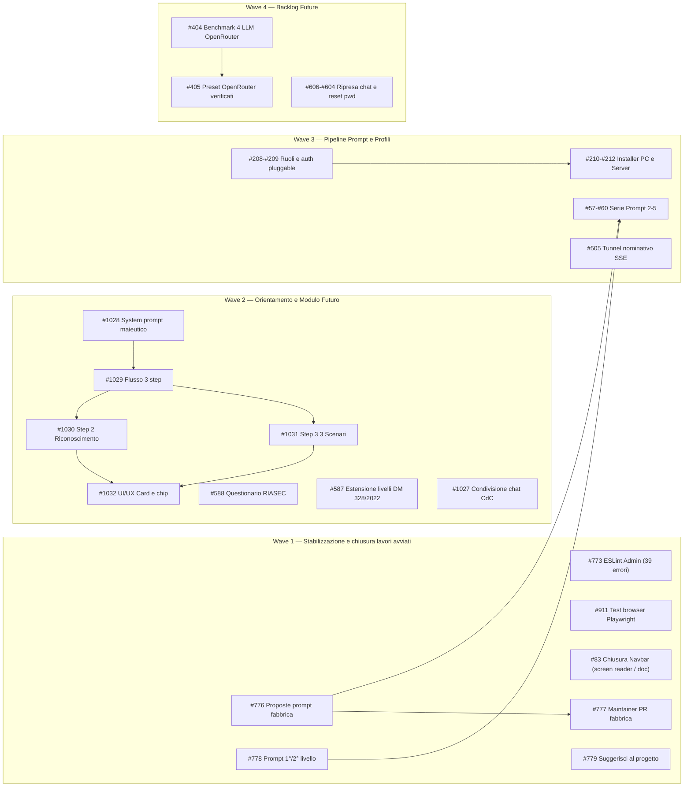

# Piano di intervento e tracciamento issue — CounselorBot

> **Ultimo aggiornamento:** 25 novembre 2026  
> **Repository:** [`nugh75/counselorbot-sbs`](https://github.com/nugh75/counselorbot-sbs) (baseline `main` @ `09cf498d`)  
> **Board GitHub Project:** [CounselorBot](https://github.com/users/nugh75/projects/5)

## Fotografia attuale

- **Issue aperte totali:** **31**
- **Milestone aperte:** **11** (più la milestone chiusa [#21](https://github.com/nugh75/counselorbot-sbs/milestone/21) che contiene ancora [#83](https://github.com/nugh75/counselorbot-sbs/issues/83))
- **Issue senza milestone:** **3** ([#1027](https://github.com/nugh75/counselorbot-sbs/issues/1027), [#157](https://github.com/nugh75/counselorbot-sbs/issues/157), [#9](https://github.com/nugh75/counselorbot-sbs/issues/9))

### Legenda stati

| Etichetta | Significato |
|---|---|
| `Pronta` | Nessun blocco aperto; può partire subito secondo le dipendenze del blocco |
| `In corso / residui` | Lavoro principale già su `main`; restano rifiniture, test o verifiche per chiudere |
| `Da valutare / sequenziale` | Da eseguire una PR alla volta o dopo il completamento del blocco precedente |
| `Future` | Backlog marcato `future`, da non avviare senza priorità/autorizzazione esplicita |
| `Bloccata da decisione` | Ferma in attesa di una scelta esplicita del proprietario del progetto |

---

## Cruscotto per Macro-Tema

| # | Macro-Tema | Milestone collegate | Issue aperte | Stato sintetico | Ondata |
|---|---|---|---|---|---|
| 1 | [Orientamento formativo e modulo «Prepariamoci al futuro»](#macro-tema-1--orientamento-formativo-e-modulo-prepariamoci-al-futuro) | [#52](https://github.com/nugh75/counselorbot-sbs/milestone/52), [#36](https://github.com/nugh75/counselorbot-sbs/milestone/36) (+ `#1027` senza ms) | **8** | `Pronta` / `In corso / residui` (`#587`) | Wave 1–2 |
| 2 | [Governance, ciclo di vita e ottimizzazione dei Prompt](#macro-tema-2--governance-ciclo-di-vita-e-ottimizzazione-dei-prompt) | [#45](https://github.com/nugh75/counselorbot-sbs/milestone/45), [#1](https://github.com/nugh75/counselorbot-sbs/milestone/1) | **8** | `Pronta` (`#776–#779`), `Da valutare / sequenziale` (`#57–#60`) | Wave 1–3 |
| 3 | [Qualità tecnica, test, lint e chiusura residui UI](#macro-tema-3--qualità-tecnica-test-lint-e-chiusura-residui-ui) | [#22](https://github.com/nugh75/counselorbot-sbs/milestone/22), [#42](https://github.com/nugh75/counselorbot-sbs/milestone/42), [#21](https://github.com/nugh75/counselorbot-sbs/milestone/21) | **3** | `In corso / residui` | Wave 1 |
| 4 | [Distribuzione autonoma, profili di installazione e app Desktop](#macro-tema-4--distribuzione-autonoma-profili-di-installazione-e-app-desktop) | [#10](https://github.com/nugh75/counselorbot-sbs/milestone/10), [#34](https://github.com/nugh75/counselorbot-sbs/milestone/34) | **5** | `In corso / residui` (`#208`, `#209`, `#505`), `Pronta` (`#210`, `#212`) | Wave 3 |
| 5 | [Modelli LLM OpenRouter e configurazioni verificate](#macro-tema-5--modelli-llm-openrouter-e-configurazioni-verificate) | [#26](https://github.com/nugh75/counselorbot-sbs/milestone/26) | **2** | `Future` | Wave 4 |
| 6 | [Backlog `future`, decisioni proprietario e questioni aperte](#macro-tema-6--backlog-future-decisioni-proprietario-e-questioni-aperte) | [#37](https://github.com/nugh75/counselorbot-sbs/milestone/37), [#9](https://github.com/nugh75/counselorbot-sbs/milestone/9) (+ `#157`, `#9` senza ms) | **5** | `Future` / `Bloccata da decisione` | Wave 4 / Parcheggio |

---

## Mappa operativa delle dipendenze

---

## Macro-Tema 1 — Orientamento formativo e modulo «Prepariamoci al futuro»

**Totale: 8 issue aperte** · **Milestone:** [#52](https://github.com/nugh75/counselorbot-sbs/milestone/52) (`5 open / 0 closed`), [#36](https://github.com/nugh75/counselorbot-sbs/milestone/36) (`2 open / 2 closed`) + 1 senza milestone.

### 1A. Modulo «Prepariamoci al futuro» (Milestone [#52](https://github.com/nugh75/counselorbot-sbs/milestone/52))

Ordine consigliato: `#1028` → `#1029` → `#1030` + `#1031` → `#1032`.

- [ ] [#1028](https://github.com/nugh75/counselorbot-sbs/issues/1028) — `feat(futuro): system prompt maieutico, approccio evolutivo e separazione vista docente/studente`
  - **Stato:** `Pronta` (progettazione aperta il 24/11/2026).
  - **Nota operativa:** passare dal consiglio prescrittivo alla consapevolezza dialogica, valorizzando passioni extra-scuola, competenze trasversali e reversibilità; mantenere la vista analitica solo lato docente in continuità con [`docs/operations/orientation-recommendation.md`](../operations/orientation-recommendation.md).
- [ ] [#1029](https://github.com/nugh75/counselorbot-sbs/issues/1029) — `feat(futuro): flusso conversazionale a 3 step per "Prepariamoci al futuro"`
  - **Stato:** `Pronta` (dipende dal contratto di `#1028`).
  - **Nota operativa:** definire la state machine (Step 1 aggancio motivazionale → Step 2 self-recognition → Step 3 proiezione 3 scenari), persistenza/ripresa sessione e uso implicito dei questionari senza sintesi ridondanti.
- [ ] [#1030](https://github.com/nugh75/counselorbot-sbs/issues/1030) — `feat(futuro): meccanica di "Riconoscimento e Scelta" (auto-percezione vs analisi AI)`
  - **Stato:** `Pronta` (dipende da `#1029`).
  - **Nota operativa:** generare un set misto (punti di forza reali, tratti affini/potenziali, distrattori opposti) e usare sia scelte sia mancate scelte per il dialogo maieutico nello Step 2.
- [ ] [#1031](https://github.com/nugh75/counselorbot-sbs/issues/1031) — `feat(futuro): generazione di 3 "Scenari Narrativi / Profili Futuri" calibrati sull'età`
  - **Stato:** `Pronta` (dipende da `#1029`).
  - **Nota operativa:** produrre 3 profili narrativi ipotetici in terza persona calibrati per età (medie/superiori) e diversificati per esplorazione per risonanza nello Step 3.
- [ ] [#1032](https://github.com/nugh75/counselorbot-sbs/issues/1032) — `feat(futuro): UI/UX card selezionabili e scelte rapide per caratteristiche e 3 scenari`
  - **Stato:** `Pronta` (dipende dai payload strutturati di `#1030` e `#1031`).
  - **Nota operativa:** chip/card a selezione multipla (Step 2) e 3 card interattive (Step 3), coerenti con `docs/design.md`, accessibili da tastiera/mobile, i18n a 6 lingue e con fallback testuale.

### 1B. Consiglio orientativo Life-Design e Questionari (Milestone [#36](https://github.com/nugh75/counselorbot-sbs/milestone/36))

- [ ] [#587](https://github.com/nugh75/counselorbot-sbs/issues/587) — `feat: bozza per il consiglio di orientamento aperta, dinamica e formativa`
  - **Stato:** `In corso / residui` — la base backend/UI (`backend/orientation_recommendation.py`, `OrientationTab.tsx`, [`docs/operations/orientation-recommendation.md`](../operations/orientation-recommendation.md)) è già in `main`.
  - **Nota operativa:** completare l'estensione ai 3 profili/livelli normativi DM 328/2022 (Secondaria I grado, Biennio/Triennio II grado) indicata nel commento del 25/10/2026 e verificare la chiusura della milestone.
- [ ] [#588](https://github.com/nugh75/counselorbot-sbs/issues/588) — `feat: questionario interessi vocazionali RIASEC / Holland (O*NET Interest Profiler)`
  - **Stato:** `Pronta`.
  - **Nota operativa:** integrare la batteria in pubblico dominio Mini-IP (30–36 item) sulle 6 dimensioni RIASEC e il codice Holland a 3 lettere.

### 1C. Condivisione col Consiglio di classe (senza milestone)

- [ ] [#1027](https://github.com/nugh75/counselorbot-sbs/issues/1027) — `feat: il docente sceglie quali parti delle chat condividere con il consiglio di classe`
  - **Stato:** `Pronta` (si consiglia di assegnarla alla Milestone [#36](https://github.com/nugh75/counselorbot-sbs/milestone/36) o a una dedicata).
  - **Nota operativa:** estendere `backend/class_council.py` per consentire al docente di selezionare chat o estratti da condividere (default nessuna), con scadenza, revoca immediata e tracciamento delle visualizzazioni in sola lettura.

---

## Macro-Tema 2 — Governance, ciclo di vita e ottimizzazione dei Prompt

**Totale: 8 issue aperte** · **Milestone:** [#45](https://github.com/nugh75/counselorbot-sbs/milestone/45) (`4 open / 3 closed`), [#1](https://github.com/nugh75/counselorbot-sbs/milestone/1) (`4 open / 19 closed`).

### 2A. Prompt Ownership & UI «Salute dei prompt» (Milestone [#45](https://github.com/nugh75/counselorbot-sbs/milestone/45))

> La fondazione [#775](https://github.com/nugh75/counselorbot-sbs/issues/775) (*DB come unica sorgente runtime dei prompt*) è stata chiusa con PR `#1037` (`09cf498d`). Per decisione del proprietario (31/10/2026), tutte le funzioni sotto convivono nella pagina **«Salute dei prompt»** in Amministrazione.

- [ ] [#776](https://github.com/nugh75/counselorbot-sbs/issues/776) — `feat: factory prompt updates arrive as proposals to accept, ignore or merge`
  - **Stato:** `Pronta` (sbloccata da `#775`).
  - **Nota operativa:** mostrare diff contro il testo dell'istanza con azioni *Accetta / Ignora / Unisci a mano*, aggiornamento automatico per i prompt mai personalizzati, contatore proposte pendenti e integrazione dell'azione bulk «Allinea prompt di fabbrica».
- [ ] [#778](https://github.com/nugh75/counselorbot-sbs/issues/778) — `feat: first-level and second-level prompts with double confirmation for first level`
  - **Stato:** `Pronta`.
  - **Nota operativa:** sfruttare il livello dichiarato nel prompt registry (`#760`, già chiusa) per imporre una schermata di conferma esplicita sulle conseguenze prima di modificare i prompt di 1° livello (contratto turno, privacy/sicurezza, formati privati, lingua).
- [ ] [#777](https://github.com/nugh75/counselorbot-sbs/issues/777) — `feat: maintainer mode to promote an instance prompt to factory via pull request`
  - **Stato:** `Pronta` (coordinare con `#776`).
  - **Nota operativa:** azione «Rendi testo di fabbrica» visibile solo sull'istanza maintainer configurata con token GitHub, per aprire una PR di aggiornamento sul file di fabbrica.
- [ ] [#779](https://github.com/nugh75/counselorbot-sbs/issues/779) — `feat: suggest an instance prompt change to the project by email or GitHub issue`
  - **Stato:** `Pronta`.
  - **Nota operativa:** da un prompt personalizzato, azione «Suggerisci al progetto» verso il maintainer via email (impostazioni mail dell'app) o GitHub issue.

### 2B. Serie Prompt guidati 2–5: consolidamento e riduzione ridondanze (Milestone [#1](https://github.com/nugh75/counselorbot-sbs/milestone/1))

> `#56` (`Prompt 1/5`) è già chiusa. Regola della milestone: **una PR per punto, in sequenza** (`#57` → `#58` → `#59` → `#60`), idealmente dopo `#776` e `#778` per proteggere le personalizzazioni salvate nel DB.

- [ ] [#57](https://github.com/nugh75/counselorbot-sbs/issues/57) — `[Prompt 2/5] refactor: consolidate shared prompt directives`
  - **Stato:** `Da valutare / sequenziale`.
  - **Nota operativa:** ridurre sovrapposizioni tra sistema, direttive, persona e contratto finale con piano DB revisionabile protetto da hash e confronto token prima/dopo.
- [ ] [#58](https://github.com/nugh75/counselorbot-sbs/issues/58) — `[Prompt 3/5] fix: remove complete optional theory blocks during compaction`
  - **Stato:** `Da valutare / sequenziale` (dopo `#57`).
  - **Nota operativa:** correggere i confini dei blocchi teorici così da rimuovere interamente la teoria facoltativa mantenendo parità tra chat, streaming, anteprima e Prompt Lab.
- [ ] [#59](https://github.com/nugh75/counselorbot-sbs/issues/59) — `[Prompt 4/5] perf: reduce unnecessary auxiliary model calls`
  - **Stato:** `Da valutare / sequenziale` (dopo `#58`).
  - **Nota operativa:** misurare separatamente risposta principale, controllo automatico, router skill e sintesi; rendere deterministiche le selezioni risolvibili da codice.
- [ ] [#60](https://github.com/nugh75/counselorbot-sbs/issues/60) — `[Prompt 5/5] refactor: streamline step transition prompt reinforcement`
  - **Stato:** `Da valutare / sequenziale` (dopo `#59`).
  - **Nota operativa:** valutare la doppia iniezione in QPCS e IDEA rispetto a un segnale breve mantenendo l'aderenza allo step.

---

## Macro-Tema 3 — Qualità tecnica, test, lint e chiusura residui UI

**Totale: 3 issue aperte** · **Milestone:** [#22](https://github.com/nugh75/counselorbot-sbs/milestone/22) (`1 open / 21 closed`), [#42](https://github.com/nugh75/counselorbot-sbs/milestone/42) (`1 open / 60 closed`), [#21](https://github.com/nugh75/counselorbot-sbs/milestone/21) *(milestone già chiusa su GitHub)*.

- [x] [#773](https://github.com/nugh75/counselorbot-sbs/issues/773) — `chore: refactor fetch-on-mount loaders flagged by react-hooks/set-state-in-effect`
  - **Milestone:** [#22 — Green test baseline](https://github.com/nugh75/counselorbot-sbs/milestone/22)
  - **Stato:** `Completata (PR in chiusura)` — dopo PR `#1035` (Chat/QSA + Docente) e PR `#1036` (Area personale), rifattorizzati gli ultimi **34 file** di `frontend/src/components/admin/` (**0 errori ESLint**) e portato `ESLINT_MAX_ERRORS` da `39` a `0` in [`.github/workflows/frontend-lint.yml`](../../.github/workflows/frontend-lint.yml).
- [ ] [#911](https://github.com/nugh75/counselorbot-sbs/issues/911) — `Rewrite stale browser tests to match the current app`
  - **Milestone:** [#42 — UI consistency](https://github.com/nugh75/counselorbot-sbs/milestone/42)
  - **Stato:** `In corso / residui` — PR `#1038` ha già aggiornato due test browser admin; restano da eseguire file per file gli altri test Playwright in `frontend/tests/` contro un dev server isolato (`docs/operations/live-dev-environment.md`).
- [ ] [#83](https://github.com/nugh75/counselorbot-sbs/issues/83) — `feat: review and redesign the top navigation bar`
  - **Milestone:** [#21 — Navbar redesign](https://github.com/nugh75/counselorbot-sbs/milestone/21) *(chiusa)*
  - **Stato:** `In corso / residui` — il redesign è già su `main`. Restano 3 verifiche residue prima della chiusura: prova con screen reader reale, controllo/rigenerazione screenshot aggiornati delle sezioni post-redesign, verifica baseline suite frontend (`#911`).

---

## Macro-Tema 4 — Distribuzione autonoma, profili di installazione e app Desktop

**Totale: 5 issue aperte** · **Milestone:** [#10](https://github.com/nugh75/counselorbot-sbs/milestone/10) (`4 open / 5 closed`), [#34](https://github.com/nugh75/counselorbot-sbs/milestone/34) (`1 open / 63 closed`).

- [ ] [#208](https://github.com/nugh75/counselorbot-sbs/issues/208) — `admin roles per profile: teacher-PC, school server, Console`
  - **Stato:** `In corso / residui` — `teacher-pc` e `Console` sono già differenziati; resta il profilo `school server` (admin di istituto distinto dal docente) con test 403 dedicati per tutti i profili.
- [ ] [#209](https://github.com/nugh75/counselorbot-sbs/issues/209) — `pluggable auth: Console/ai4auth, local auth for teacher PC, institute auth for school server`
  - **Stato:** `In corso / residui` — in [`backend/auth.py`](../../backend/auth.py) sono già implementati `ai4auth` e `local`. Mancano il provider `institute` (con reset password e rate limiting) e il coordinamento OIDC con `ai4auth` centrale (`console-platform#114`).
- [ ] [#210](https://github.com/nugh75/counselorbot-sbs/issues/210) — `installer for Mac/PC: generate local .env, store API keys locally, start stack, health check`
  - **Stato:** `Pronta` (coordinata con `#208`/`#209`).
  - **Nota operativa:** completare flusso di installazione locale per Mac/PC con generazione segreti in `.env`, richiesta locale delle API key, avvio Docker e smoke test di health check.
- [ ] [#212](https://github.com/nugh75/counselorbot-sbs/issues/212) — `school server profile without Console: institute installation, backups, updates, TLS`
  - **Stato:** `Pronta` (dipende da `#208` e `#209`).
  - **Nota operativa:** pacchetto e procedura documentata/testata per server scolastico autonomo (installazione, backup/ripristino, aggiornamenti e TLS).
- [ ] [#505](https://github.com/nugh75/counselorbot-sbs/issues/505) — `F0-03: Measure Cloudflare tunnel behaviour for chat SSE`
  - **Milestone:** [#34 — Desktop apps](https://github.com/nugh75/counselorbot-sbs/milestone/34)
  - **Stato:** `In corso / residui` — la spike su quick tunnel è già chiusa in [`docs/architecture/spikes/f0-03-tunnel-sse.md`](../architecture/spikes/f0-03-tunnel-sse.md). Restano: misure su tunnel nominativo (richiede login Cloudflare del proprietario) e conteggio richieste per pagina su browser HAR nel profilo `teacher-pc`.

---

## Macro-Tema 5 — Modelli LLM OpenRouter e configurazioni verificate

**Totale: 2 issue aperte** · **Milestone:** [#26](https://github.com/nugh75/counselorbot-sbs/milestone/26) (`2 open / 2 closed`; `#402` e `#403` già chiuse).

- [ ] [#404](https://github.com/nugh75/counselorbot-sbs/issues/404) — `test: confrontare quattro LLM OpenRouter sui percorsi Counselorbot`
  - **Stato:** `Future` (etichetta `future`; non avviare chiamate LLM a pagamento senza ok esplicito).
  - **Nota operativa:** confronto su qualità educativa, latenza, affidabilità e costo per turno su `anthropic/claude-sonnet-5.5`, `openai/gpt-6.1-sol`, `anthropic/claude-haiku-5.5` e `google/gemini-4-argon`.
- [ ] [#405](https://github.com/nugh75/counselorbot-sbs/issues/405) — `feat: proporre preset OpenRouter verificati con una guida alla scelta`
  - **Stato:** `Future` (dipende da `#404`).
  - **Nota operativa:** tradurre i risultati del benchmark in preset consigliati e adottabili esplicitamente dall'amministratore.

---

## Macro-Tema 6 — Backlog `future`, decisioni proprietario e questioni aperte

**Totale: 5 issue aperte** · **Milestone:** [#37](https://github.com/nugh75/counselorbot-sbs/milestone/37) (`2 open / 18 closed`), [#9](https://github.com/nugh75/counselorbot-sbs/milestone/9) (`1 open / 0 closed`) + 2 senza milestone.

- [ ] [#606](https://github.com/nugh75/counselorbot-sbs/issues/606) — `feat(piani): riprendere una conversazione già avviata dal punto interrotto`
  - **Milestone:** [#37 — Incontro tutor QPCC 26/10](https://github.com/nugh75/counselorbot-sbs/milestone/37) · **Stato:** `Future`
- [ ] [#604](https://github.com/nugh75/counselorbot-sbs/issues/604) — `feat(auth): recupero e reimpostazione autonoma della password`
  - **Milestone:** [#37 — Incontro tutor QPCC 26/10](https://github.com/nugh75/counselorbot-sbs/milestone/37) · **Stato:** `Future` *(coordinare con `#209` / `ai4auth`)*
- [ ] [#157](https://github.com/nugh75/counselorbot-sbs/issues/157) — `Import competenzestrategiche.it factor results with teacher-confirmed student matching`
  - **Milestone:** nessuna · **Stato:** `Future` *(non avviare finché non sono definiti contratti export e decisioni operative)*
- [ ] [#135](https://github.com/nugh75/counselorbot-sbs/issues/135) — `chore: code-sign the ChatGPT helpers for Windows and macOS`
  - **Milestone:** [#9 — Helper code signing](https://github.com/nugh75/counselorbot-sbs/milestone/9) · **Stato:** `Bloccata da decisione` (`blocked: owner decision` — scelta su firma/certificati Windows OV/EV e Apple Developer Program)
- [ ] [#9](https://github.com/nugh75/counselorbot-sbs/issues/9) — `Nome`
  - **Milestone:** nessuna · **Stato:** `Da valutare` (nota sul nome «Counselorbot» per parlanti inglesi; vedi [`docs/rebranding-compassbot-proposal.md`](../rebranding-compassbot-proposal.md))

---

## Ordine operativo consigliato (Ondate)

1. **Wave 1 — Chiusure rapide e completamento «Prompt ownership»:**
   - Azzerare gli ultimi 39 errori ESLint in **#773** (chiusura Milestone [#22](https://github.com/nugh75/counselorbot-sbs/milestone/22)).
   - Completare **#911** (Playwright) e verificare i 3 residui di **#83** (chiusura Milestone [#42](https://github.com/nugh75/counselorbot-sbs/milestone/42)).
   - Completare la pagina «Salute dei prompt» con **#776 → #778 → #777 → #779** (chiusura Milestone [#45](https://github.com/nugh75/counselorbot-sbs/milestone/45)).
2. **Wave 2 — Valore didattico e orientamento:**
   - Avviare il nuovo modulo **«Prepariamoci al futuro»** in sequenza: **#1028 → #1029 → #1030 + #1031 → #1032** (Milestone [#52](https://github.com/nugh75/counselorbot-sbs/milestone/52)).
   - Completare **#587** (livelli DM 328/2022) e sviluppare **#588** (RIASEC) + **#1027** (condivisione selettiva chat con Consiglio di classe).
3. **Wave 3 — Ottimizzazione Prompt e Profili di installazione:**
   - Serie sequenziale **#57 → #58 → #59 → #60** (Milestone [#1](https://github.com/nugh75/counselorbot-sbs/milestone/1)).
   - Profilo `school server` e installer: **#208 + #209 → #210 + #212** (coordinando `#209` con OIDC `ai4auth`), più verifica manuale **#505** quando disponibile login Cloudflare.
4. **Wave 4 — Backlog `future` e decisioni:**
   - Benchmark **#404 → #405** solo su autorizzazione esplicita ai test LLM; **#606**, **#604**, **#157** su pianificazione successiva; **#135** e **#9** in attesa di decisione del proprietario.

---

## Note di igiene GitHub suggerite

- **Issue senza milestone (3):** assegnare una milestone o chiudere/archiviare `#1027` (es. in `#36` o nuova milestone Consiglio di classe), `#157` e `#9` per mantenere la board allineata.
- **Milestone [#21](https://github.com/nugh75/counselorbot-sbs/milestone/21) chiusa con [#83](https://github.com/nugh75/counselorbot-sbs/issues/83) aperta:** eseguire le verifiche residue e chiudere `#83` (oppure spostare i residui in `#911` / `#42`).
- **Issue con lavoro parziale già su `main`:** `#587`, `#773`, `#911`, `#83`, `#208`, `#209`, `#505` — verificare sempre lo stato reale su codice prima di aprire nuovi task agli agenti.
